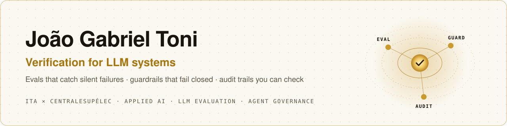

<picture>
  <source media="(prefers-color-scheme: dark)" srcset="assets/banner-dark.svg">
  
</picture>

  
  
  

I make LLM systems safe to ship and easy to check: evaluation sets that catch
silent failures, guardrails that fail closed, and audit trails a third party can
verify.

ITA × CentraleSupélec · Rennes → Paris-Saclay (January 2027)

**Open to:** a 2027 engineering internship (from 26 April, ~21 weeks) in Applied
AI, Forward-Deployed or LLMOps roles.

## Public work

### Mapa de Falhas · open PT-BR failure map for LLM support assistants *(in review, January 2027)*

An open evaluation set and harness for Portuguese-language customer-support
assistants: 260 cases in 12 failure categories (leaked synthetic CPFs and phone
numbers, prompt injection written in Portuguese, LGPD deletion requests, invented
answers outside the knowledge base, drift in long conversations), a fictional
company's knowledge base with deliberate traps, and a reference RAG app with five
configurations. Data CC BY 4.0, code MIT.

### [Verifiable Agent Runtime](https://github.com/JoaoToni12/verifiable-agent-runtime)

A clean-room FastAPI control plane for policy-gated AI actions: payload-bound
approvals, request-bound idempotency, deterministic risk policies, shadow and
kill-switch modes, and a hash-chained audit ledger. Strict typing, tests, CI,
Docker Compose, Kubernetes manifests, a threat model and an ADR.

### [ALL-ABT-CLAUDE · Claude Code guardrails](https://github.com/JoaoToni12/ALL-ABT-CLAUDE)

Deterministic `PreToolUse` and `PostToolUse` hooks that classify shell and write
actions as allow, ask or deny; fail closed on malformed input; block path and
symlink escapes; and validate JSON after edits without echoing file contents.
46 dependency-free tests, CI on Node.js 22 and 24, a threat model and versioned
policy.

## Production scope

My employer repositories remain private. The numbers below describe my verified
scope at **NG.CASH**; no company source code, data, prompts, workflows or
business rules are published here.

| Evidence | Scope |
|---|---|
| Repository contribution | Primary contributor across **18 private repositories** and roughly **760 commits** |
| Workflow engineering | Created most of approximately **148 production-orchestrator workflows** across **7 workspaces**; maintained or governed roughly half |
| LLM evaluation | Built a **1,000-question** graded set, including **950 expected-source labels** for citation-correctness evaluation |
| Agentic reporting | Developed a **63-node** weekly pipeline with **16 prompt-specialized analysts** and a synthesis stage |
| Operational outcomes | Replaced reporting and curation processes measured at approximately **15 hours/month** and **2–3 hours/week** respectively |

## What I work on

- **Evaluation:** citation-correctness scoring, adversarial and out-of-corpus
  cases, multi-turn behaviour, prompt-injection and PII-leak tests.
- **Guardrails and governance:** policy gates, human approval bound to the exact
  action, fail-closed defaults, tamper-evident logs.
- **Reliability:** monitoring for explicit failures and silent non-execution,
  PII-safe alerts, health checks outside the primary orchestrator.
- **Production AI systems:** source-grounded assistants, constrained tool use,
  prompt caching and cost-aware model routing.

## Stack

`Python` · `SQL` · `FastAPI` · `Claude Code` · `n8n` · `Snowflake` · `REST APIs`
· `Docker` · `Kubernetes` · `ArgoCD` · `CI/CD` · `Git` · `Linux`

## Education

- **CentraleSupélec** · double-degree Engineering Curriculum, Electronics, 2026–2028.
- **Instituto Tecnológico de Aeronáutica (ITA)** · Electronics Engineering,
  expected 2028; GPA 8.63/10, ranked 3rd of 20.

> Public repositories are independent clean-room work built with synthetic data
> and public interfaces. Employer systems and implementation details stay private.
